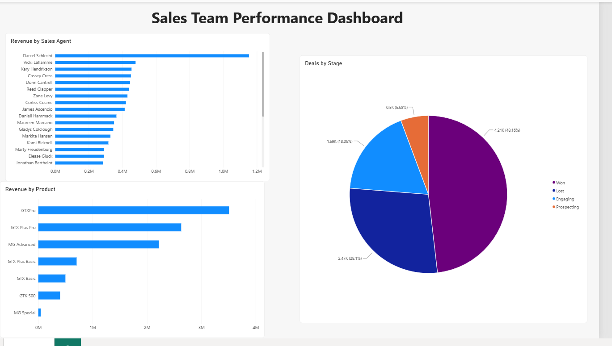

# CRM Sales Dashboard (Power BI)

A Power BI dashboard that shows a sales manager **who sells best, what sells best, and how often we win deals**, built from 8,800 B2B sales deals.

## The brief
"I need a quick view of how our sales team is doing. Who's closing deals and who isn't? Which products sell best? Keep it simple."

## Questions answered
1. Which sales agents bring in the most money?
2. Which products bring in the most money?
3. What % of closed deals do we win?

## Key findings
- **Top agent: Darcel Schlecht ($1.15M).** Darcel has the most deals (747 vs about 290 for a typical agent) AND earns more per deal ($1,540 vs $1,064 for the next agent).
- **Top product: GTXPro ($3.5M), because it is expensive ($4,821), not because it sells most.** GTX Basic sells most often (1,866 deals) but is cheap ($550), so it brings in little money.
- **3 products bring in about 83% of revenue.** MG Special brings in almost nothing.
- **Win rate: 63%** of closed deals are won (4,240 won vs 2,470 lost). About 2,090 deals are still open.

## Recommendations
1. Learn from Darcel's approach and share it with the team.
2. Focus sales effort on the high-value products (GTXPro, GTX Plus Pro, MG Advanced).
3. Review MG Special: keep, reprice or drop it.

## How I checked the numbers
- A big total can come from more deals or from bigger deals, so I checked both (count of deals, and money per deal).
- The pie chart shows 48% won, but that includes open deals. The real win rate only counts closed deals: Won ÷ (Won + Lost) = 63%.

## Tools
Power BI Desktop (bar charts, pie chart, counts, formatting)

## Data
[CRM Sales Opportunities](https://mavenanalytics.io/data-playground) by Maven Analytics (free). The CSV files are not uploaded; download them from the link.

## Files
- `crm-sales-dashboard.pbix`: the Power BI file
- `images/dashboard.png`: dashboard screenshot
